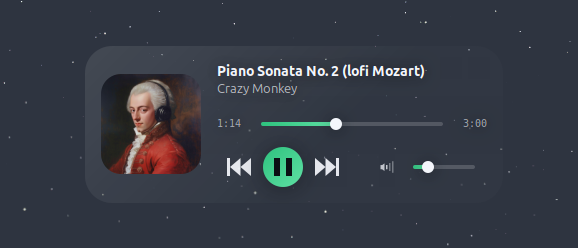

# Spotify Widget

A small translucent glass card for your Linux desktop that shows what Spotify is playing. It has album art, title and artist, previous / play-pause / next, a seek bar and a volume slider. Show or hide it with a keyboard shortcut.



## Features

- Glass card with album art, track info, seek bar and volume
- Optional accent color taken from the album cover
- Settings window with live preview: colors, opacity, corner radius, font, size, position, monitor
- Works with any player that `playerctl` can see, not just Spotify
- Show / hide with one keyboard shortcut (Ctrl+Alt+S by default after setup)
- Drag the card anywhere and it remembers where you left it
- Does no work while hidden

## Install

```bash
git clone https://github.com/Umbra-Domini/spotify-widget.git
cd spotify-widget
./install/setup.sh
```

The setup script installs the dependencies (apt, dnf and pacman are supported), sets **Ctrl+Alt+S** as the show / hide shortcut, and starts the widget hidden. Press the shortcut to see it.

Options: `--no-deps` skips the package install, `--no-shortcut` skips the shortcut.

If you'd rather do it by hand, you need Python 3, PyGObject with GTK 3, and `playerctl`. For the built-in shortcut you also need keybinder:

```bash
sudo apt install python3-gi python3-gi-cairo gir1.2-gtk-3.0 playerctl gir1.2-keybinder-3.0
```

## Usage

```bash
python3 spotify-widget.py            # start (hidden until you press the shortcut)
python3 spotify-widget.py toggle     # show / hide
python3 spotify-widget.py settings   # open the settings window
python3 spotify-widget.py quit       # stop the widget
```

You can also right-click the card, or hover it and click the gear icon, to open settings.

## Shortcuts on Wayland

On X11 the built-in shortcut (Settings > Behavior > Global shortcut) works from anywhere.

On Wayland it only works while an X11 window has focus, so you need a shortcut from your desktop instead. On GNOME, `./install/setup.sh` sets this up for you. On other desktops, add a custom shortcut in your keyboard settings with this command (use the real path to the file):

```bash
python3 /full/path/to/spotify-widget.py toggle
```

- **KDE Plasma:** System Settings > Shortcuts > Add Command
- **XFCE:** Settings > Keyboard > Application Shortcuts
- **Others:** look for "custom shortcuts" in your keyboard settings

The command also starts the widget if it isn't running.

## Settings

Everything is in the settings window and saves as you change it. The file is `~/.config/spotify-widget/config.json`. Delete it or use "Reset to defaults" to start over.

To use another player, set Player in Settings > Behavior to its `playerctl` name. Run `playerctl -l` to list them.

## Troubleshooting

- **"Spotify isn't running":** start the player, or check the name with `playerctl -l`.
- **"playerctl isn't installed":** `sudo apt install playerctl`.
- **Shortcut does nothing:** see [Shortcuts on Wayland](#shortcuts-on-wayland). If the settings window says the shortcut couldn't be registered, another app already uses that combination.
- **Run it in a terminal** (`python3 spotify-widget.py`) to see any errors.

## Files

| File | What it does |
| --- | --- |
| `spotify-widget.py` | The widget itself |
| `sw_config.py` | Defaults, validation, loading and saving settings |
| `sw_style.py` | Builds the CSS from your settings |
| `sw_settings.py` | The settings window |
| `install/setup.sh` | Installs dependencies and sets the shortcut |

Keep the four `.py` files in the same folder.

## License

MIT, see [LICENSE](LICENSE).
